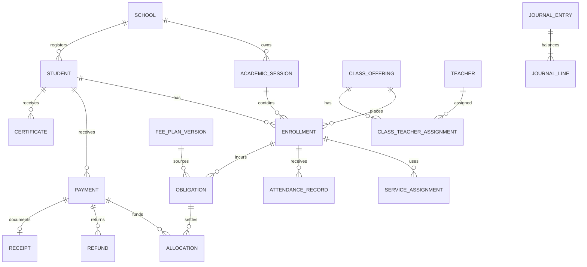

# Technical Requirements Document — school ERP

**Version:** 0.5, revised 14 October 2026 (legacy audit: 4 October 2026)

**Status:** target technical contract; Levels 1–3 and the synthetic Level 4 demo controls are implemented, not production-complete
**Product contract:** [prd.md](prd.md)  
**Legacy evidence:** [feature-audit.md](feature-audit.md)

## Current implementation boundary

- Actual folders are `backend/` (NestJS/Prisma/PostgreSQL), `frontend/` (Next.js/React/TypeScript and custom CSS), and `tools/` (management DOCX generation/validation). The larger topology below is the target, not a request to move the existing applications or install additional UI packages.
- The API implements identity, admissions/enrollment, academic setup, private student documents, versioned fee assessment, services, transport and store operations. The frontend calls same-origin `/api/v1`, proxied to `API_INTERNAL_URL`; `/health` checks API/database readiness.
- Level 4 uses `PaymentQuote`, `Payment`, allocation/application/release records, `Receipt`/events/sequence, `PaymentRefund`, `RefundCommand`, `CashierShift`, correction requests, cash movements, policy versions, journal entries/lines and `ReceiptPdfJob`. BigInt paise values serialize as strings. Serializable transactions, bounded retries, unique command/quote/receipt constraints and balance checks protect posting. Database triggers prevent receipt-snapshot, journal and financial-lineage rewrites.
- Payment capture is idempotent by school/cashier/key and request hash; retry returns the existing payment and receipt with current status. Partial refunds store their original response by school/actor/key. Manual electronic capture requires explicit staff verification/evidence; a school/channel/trimmed-reference unique index prevents reuse. This is not bank verification or gateway integration.
- Pending cheques reserve no balance and issue no final receipt. Clearance recalculates allocation from current balances. Accountants submit correction requests; Admin/Superadmin decisions retain original history and require the applicable open payout shift for cash. Direct correction endpoints remain audited privileged controls.
- Receipts are immutable JSON snapshots with browser reprint history. Current-status PDF jobs are generated by a bounded in-API worker and stored as private PostgreSQL bytes for the synthetic demo. The demo policy controls school/financial-year receipt scope and prefix without rewriting old snapshots.
- Remaining production controls include approved policy/rates, external bank/refund settlement, printer/font approval, private object storage/separate worker, school UAT, backups/restore, live migration and operational release gates. Traceable spent-credit reversal is supported; missing historical lineage remains visible and blocks unsafe correction.

Sixteen migrations exist. Deploy reviewed migrations with `npm --prefix backend run db:migrate`, not `db push`. Financial-history triggers and opening-entry backfills are part of the reviewed migration path; old records are not retroactively marked verified. See [backend/README.md](backend/README.md) for the implemented API, [PROGRESS.md](PROGRESS.md) for the 82 backend test suites and priority gates, and [roadmap.md](roadmap.md) for the re-baselined P0/P1/P2 priorities.

## 1. Architecture decision

Build a **modular monolith** with one authoritative relational database, explicit business modules, and a background worker. Fee correctness and maintainability take precedence over distributing a small school's transactions across services. The initial deployment serves one school with one Superadmin; retain school scoping in the model for a future multi-school expansion.

### Recommended stack

| Layer | Recommendation | Rationale |
|---|---|---|
| Web | Next.js + React + TypeScript | Search/table/form ecosystem, responsive application shell, typed integration |
| UI | Tailwind CSS, accessible Radix/shadcn-style primitives, TanStack Table, React Hook Form | Consistent accessible controls and efficient dense office screens |
| Charts | Recharts | React-friendly charts for management dashboards; charts are optional on cashier screens and never the source of financial truth |
| API | NestJS + TypeScript, REST/OpenAPI | Explicit modules, validation, guards, transactions and testable services |
| Database | PostgreSQL, supported stable release | Transactions, constraints, row locking, reporting and point-in-time recovery |
| Data access | Prisma with reviewed SQL migrations/raw SQL where required | Typed access; SQL for partial indexes, locks and financial constraints |
| Jobs | PostgreSQL-backed queue such as pg-boss; transactional outbox | Durable PDF/import/reminder work without requiring another core datastore |
| Files | Private S3-compatible object storage | Documents, photographs, receipt/certificate PDFs, export artifacts |
| PDF | Server-side HTML/CSS templates rendered with Playwright/Chromium in worker | Predictable print layouts and immutable snapshots |
| Tests | Unit/integration tests, real PostgreSQL test database, Playwright E2E | Calculation, concurrency, authorization and user workflow coverage |
| Deployment | Render frontend/API/worker services, managed TLS, paid PostgreSQL for production, private S3-compatible storage | Repeatable staging/production; health checks and uptime alerts; no reliance on ephemeral local files |

The applications have package lockfiles and the existing stack must be preserved. The current bounded worker and PDF renderer are intentionally a small demo implementation; production should move PDF/document work to a durable worker and private object storage. The legacy source exposed PHP-style paths and JavaScript libraries, but its full server architecture was not inspected.

### Logical topology

```text
Staff browser / future parent browser
              │ HTTPS
       Web application + same-origin /api proxy
              │
       API modular monolith
       ├─ Identity / school scope / permissions
       ├─ Masters / sessions / class structure
       ├─ Applications / students / enrollments
       ├─ Fee plans / obligations / adjustments
       ├─ Payments / allocation / receipts / day close
       ├─ Services / lifecycle / certificates
       ├─ Reports / audit / migration
       └─ Outbox
              │
         PostgreSQL ── worker ── private document storage
                          └──── approved payment/message providers (later)
```

Financial commit never depends on successful PDF rendering or SMS delivery. Those tasks consume committed outbox events and are retryable.

### Confirmed account hierarchy and scope

- **Superadmin:** one initial account with full operational access to the single school; manages Admin creation, deactivation, reset, and permissions. The initial provisioning workflow creates Admin accounts only; Admin creates Accountant/Teacher accounts. Only Superadmin deactivates Admin accounts. The model permits this Superadmin to administer future school boundaries; creating another Superadmin is outside the initial workflow.
- **Admin:** may create Admin, Accountant, and Teacher accounts; manages/deactivates Accountant and Teacher accounts; manages fee plans, classroom assignments, attendance approvals, promotion oversight, and school finance.
- **Accountant:** controls fee accounting, payment collection, receipts, outstanding balances, student credit, and reconciliation. Exceptional changes use an Admin special-access request.
- **Teacher:** accesses only the assigned classroom; marks day-wise attendance; requests Admin-approved corrections after submission; makes final Promote/Retain decisions for that classroom.

Use API guards and database-scoped queries for these rules. Menu filtering is only a usability feature. Accounts with historical activity are deactivated rather than deleted.

### Render health and uptime monitoring

The API must expose an unauthenticated, non-sensitive `GET /health` endpoint returning a fast `2xx` response when the process and required database connectivity are ready. Configure this endpoint as the Render HTTP health check so Render can stop routing traffic to an unhealthy instance and restart it when consecutive checks fail.

Configure an external uptime monitor to request `/health` at a reasonable interval and notify the technical owner when the endpoint is unavailable, returns an unhealthy status, or exceeds the agreed response-time threshold. Uptime requests may reduce idle periods on a Free Render web service, but they do not remove cold starts, guarantee availability, replace a paid production instance, or replace backups. The monitor must not be used as the financial transaction safety mechanism.

## 2. Target repository structure (not the current layout)

The implemented project uses `backend/`, `frontend/`, and `tools/`; use those folders for all current commands. The original layout proposal below is retained as design context only. No repository migration is required for the next Level 4 task.

```text
apps/
  web/                # staff UI; future parent routes isolated by permissions
  api/                # NestJS modules and HTTP controllers
  worker/             # PDFs, imports, exports, reminders, reconciliations
packages/
  contracts/          # API schemas, generated client, shared validation shapes
  domain/             # money, dates, fee calculation and transition rules
  ui/                 # shared visual components
  config/             # lint/typescript/build configuration
database/
  migrations/
  seeds/              # synthetic examples and approved masters only
tests/
  integration/
  e2e/
infra/
README.md
feature-audit.md
reference-data.md
prd.md
trd.md
design.md
roadmap.md
```

API controllers validate/authorize and call application services. Domain services implement rules. Repositories enforce school scoping and persistence. UI code never owns authoritative financial calculations.

## 3. Domain model

All business entities include an opaque internal ID; school-scoped entities include `school_id`. Dates, actor metadata and status history are explicit. UUID/UUIDv7 is a suitable internal ID; human admission/receipt numbers remain separate.

| Entity | Key attributes / relationships |
|---|---|
| School | Legal/display name, contact, branding, timezone, approved configuration |
| User / Membership / Role / Permission | Identity; per-school membership; action/data scopes; active status |
| AcademicSession | School, name, start/end, admission-open, operational state |
| Grade / Section / ClassOffering | Grade/stream/section, session, capacity, next-offering mapping |
| Subject / OfferingSubject | Codes, names, order, association and activity type |
| Family / Guardian / StudentGuardian | Verified relationships, contact preference, legal/communication roles |
| Application / ApplicationEvent | Applicant data, applied grade/session, source, follow-up, stage, decision |
| Student | Permanent school identity, unique admission number, profile, original admission date, version |
| Enrollment | Student, session, class offering, entry type, fee category/EWS, start/end, status/outcome |
| EnrollmentEvent | Promotion, class change, withdrawal, restoration, decision/actor/date and linkage |
| Document | Owner/type/storage key/hash/version, uploaded/verified metadata |
| FeeHead | Stable code, label, category, revenue mapping, active status |
| FeePlan / FeePlanVersion | School/session/class/category eligibility, draft/published status, effective dates |
| FeeRule | Head, amount/rate, recurrence, assessment dates, eligibility, proration policy, rule version |
| ServiceAssignment | Enrollment, transport/hostel/service, route/price version, start/end, status |
| Route / Vehicle / ServicePrice | Operational masters, capacity and dated prices |
| StoreGroup / StoreCluster / StoreVendor | Store classification, reusable issue bundles, and supplier records |
| StoreProduct | Product description, group, unit cost, alert quantity, and current stock |
| StoreStockReceipt / StoreStockMovement | Stock received, stock issued/returned/adjusted, actor, reason, and source history |
| StoreIssue / StoreIssueLine | Student enrollment, issued products, quantities, open balance, cancellation history |
| Obligation | Student/enrollment, session, head, service period, due date, assessed amount, source/rule |
| Adjustment / ConcessionAssignment | Debit/credit adjustment or rule assignment, head/period, amount, reason, approval |
| Payment | Student/payer, received amount, currency, mode/submode, business date, status, bank reference |
| PaymentEvent | Capture, cheque clearance/bounce, verification, reversal, refund linkage, event time |
| Allocation / AllocationEvent | Amount of a captured payment applied to an obligation; releases recorded separately |
| Refund | Original payment, amount, mode/reference, status, reason, approver |
| Receipt / ReceiptLine / ReceiptEvent | Unique number, payment, immutable snapshot, template version, status, PDF, print history |
| JournalEntry / JournalLine | Balanced financial events; source event, account, student dimension, debit/credit |
| CashierShift / DayClose / CashMovement | Float, collections, cash refunds, deposit/handover, count, variance, closure |
| WithdrawalRequest / ClearanceItem | Effective date, reason, approvals, service cutoffs, balance/exception snapshot |
| Certificate / CertificateVersion | Type/number, student, verified fields, issue/cancel/supersede, PDF |
| PromotionBatch / PromotionItem | Source/target session, decisions, validation results, outcome, idempotent progress |
| ClassTeacherAssignment | Teacher, session, class offering, start/end, assigned-by actor; at most one active class-teacher assignment per teacher/session |
| AttendanceRecord / AttendanceCorrectionRequest | Enrollment/classroom, date, status, actor, submission state, original/proposed value, reason, Admin approval/rejection |
| AccessRequest | Accountant request, target student/payment/fee event, requested change, reason, financial effect, Admin decision, audit linkage |
| Notification | Recipient, type, linked record/version, channel, read/delivery state, retry metadata |
| ImportBatch / ImportRow / LegacyMapping | Source hash/ID, mapping/version, validation/import outcome, reconciliation |
| LegacyReceipt | Original external number/date/details/document, read-only reference mode when applicable |
| AuditEvent / OutboxEvent / IdempotencyRecord | Actor/change trace, committed integration work, retry-safe result |

### Relationship outline



One P0 payment belongs to one student; the payer may be a guardian. P1 family tender is modeled as a parent transaction with child student payments/allocations and a documented receipt policy, rather than overloading P0 relationships.

## 4. Required database invariants

- Unique school/admission-number combination; preserve legacy exceptions through a reviewed mapping, not silent renumbering.
- Admission number is the primary school-facing identifier for search, fee, receipt, attendance, promotion, and reports; it is never reused after withdrawal or graduation.
- One enrollment per school/student/session under the initial model. In-session class/section changes are dated events/placement history, not duplicate enrollments. If the school needs multi-enrollment per session, revise this rule before implementation.
- Unique class offering per school/session/grade/stream/section.
- Only one current operational session per school using a partial unique index.
- Composite school/entity foreign keys prevent linking objects across schools.
- One assessed obligation per explicit source rule/assignment, enrollment, head and occurrence. Use a deterministic occurrence key for annual installments and date intervals, not only a month number.
- Published fee versions and posted financial amounts are immutable. Corrections append linked entries.
- Money fields use signed/unsigned constraints appropriate to their entity; allocations/payments/refunds are positive. Adjustment direction is explicit.
- Receipt number unique within school/series; receipt-to-payment uniqueness for the P0 final receipt. No receipt number reuse after voiding.
- Unique school/provider/event ID; unique idempotency scope/key; unique import source-system/entity/source-ID mapping.
- Service assignment intervals cannot overlap for the same exclusive service where school rules require exclusivity.
- Journal lines balance for every posted entry; enforce posting through a single transaction/service and a database constraint trigger or equivalent reviewed mechanism.
- Financial history cannot be removed through cascading deletes.
- Optimistic `version` field for mutable profile/configuration records; conflict produces HTTP 409 with a re-fetch path.
- At most one active class-teacher assignment per school/teacher/session; assignment changes are effective-dated and audited.
- Attendance correction cannot change a submitted record until an approved Admin decision exists; original and corrected values remain linked.
- Teacher classroom queries are scoped by active class-teacher assignment; manually altered object IDs cannot widen access.
- Student credit is owned by one student and cannot be allocated to a sibling without an explicit approved operation.

## 5. Money, dates, and fee calculation

### Representation

- Store INR amounts as **integer paise in `BIGINT`**. Use BigInt-safe domain operations. Serialize money as decimal strings in JSON (`"129000"` = ₹1,290.00), never an imprecise JavaScript float.
- Percentages use explicit basis points or fixed decimal representation; approved rounding mode is half-up at the charge-line level unless the school decides otherwise.
- Calendar business dates use PostgreSQL `DATE`; event timestamps use `TIMESTAMPTZ` in UTC. Display and business-day boundaries use **Asia/Kolkata**.
- Session boundaries are dates, not assumptions about server year. Financial year, academic year, and receipt series scope are separate configuration decisions.

### Assessment algorithm

1. Identify school, enrollment, business date and billable service periods.
2. Resolve the applicable published plan version and dated service prices.
3. Determine eligible monthly, annual/half-yearly, admission, promotion/readmission and optional heads.
4. Apply approved joining/leaving/proration policies and occurrence schedule.
5. Calculate eligible concessions/waivers in a deterministic documented order with caps.
6. Assess late-fine rules using due date, cutoff, grace period and previously assessed occurrences.
7. Produce an itemized preview explaining every source and adjustment.
8. Commit previously unassessed obligations exactly once; never duplicate a charge because a user opens a screen.

The legacy matrix is reference input only. Annual dates, examination recurrence, admission applicability, EWS and concession rules need approval before publishing production plans.

### Balance equations

For one obligation:

```text
net_assessed = original_assessment + debit_adjustments - credit_adjustments
net_allocated = allocation_events - allocation_release_events
outstanding = net_assessed - net_allocated
```

Never reduce net assessment below net allocated without first releasing/reallocating the excess. Outstanding must not become negative; excess funds belong in credit.

For one payment:

```text
available_credit = captured_amount
                 - net_active_allocations
                 - completed_refunds
                 - reversed_unallocated_amount
```

When reversing/refunding allocated funds, release the affected allocation first in the same transaction. A refund restores the receivable unless a distinct credit adjustment waives that obligation. Student account summaries present gross outstanding and available credit separately. The default automatic credit policy applies available credit to the same student's oldest eligible fee through an explicit audited allocation, not hidden subtraction; sibling transfer and refund require Admin authorization.

## 6. Financial posting model

Use a minimal double-entry financial journal even if full general-ledger UI is deferred. Separate payment capture, obligation settlement, refunds and bank settlement.

| Event | Debit | Credit |
|---|---|---|
| Assess fee | Student receivable | Fee income by head |
| Capture cash/verified bank payment | Cash/bank or provider clearing | Student unapplied credit |
| Apply payment to fee | Student unapplied credit | Student receivable |
| Release an allocation | Student receivable | Student unapplied credit |
| Refund available credit | Student unapplied credit | Cash/bank/clearing |
| Approved fee waiver | Concession/contra-income | Student receivable |
| Reverse a captured payment | Student unapplied credit (after allocation release) | Cash/bank/clearing |
| Settle gateway balance to bank | Bank and separately identified provider expense | Provider clearing |

This journal is a proposed operational accounting design, subject to accountant validation. Do not assume the legacy Finance module uses it. Journal/obligation/allocation changes and the audit event commit together.

## 7. Payment transaction and concurrency

### Collection contract

The following is the full target contract. Current staging quotes accept `{ studentId, amountMinor }` and allocate automatically across eligible fee/store dues. Steps involving selected periods, journal and outbox remain incomplete; the implemented receipt snapshot is independent of browser printing, but there is no PDF job yet. Recovery currently replays the frozen POST with the same key rather than querying a separate command-status endpoint.

1. UI requests a server-calculated quote for selected obligations/periods and proposed received amount.
2. Quote includes source versions, allocation order, itemized totals, balance/credit effects and expiry. It does not post money.
3. UI sends the quote ID/version, payment details and an `Idempotency-Key` to the payment command.
4. Server checks membership, permission, school/session policy, open cashier shift, and request hash.
5. In one database transaction, lock affected obligations/payment-credit records in stable order; recalculate against current data.
6. Reject stale/invalid quote with an actionable conflict response. Do not silently charge a different amount.
7. Create payment, allocations, journal, receipt snapshot/number, audit and outbox records atomically.
8. Persist the response reference for idempotent retry. If the response is lost, a repeated request returns the same payment/receipt.
9. Worker renders PDF and notifications after commit. UI can show the committed receipt data while a PDF is pending.

### Idempotency details

- Scope: school + authenticated actor/client + operation + key; provider events use provider account + event ID.
- Same key/same request hash returns the existing result; same key/different payload returns 409.
- Concurrent submissions with the same key synchronize through a unique constraint and transaction state.
- Financial command references must survive the maximum supported retry/reconciliation window; do not delete them on a short cache TTL.
- UI disabling a button is useful feedback, not the duplicate-payment protection.
- Keep transactions short; bounded retries for serialization/deadlock errors; never blindly retry a non-idempotent external refund.

### Modes

- **Cash:** captured at authorized collection; distinguish amount received from cash tendered/change.
- **Manual electronic:** record submode and reference; require the school’s verification process before capture. A selected “GooglePay” label is not payment confirmation.
- **Cheque:** Pending with details and acknowledgment; capture/settled receipt on clearance under the proposed default. A bounce assesses the approved charge once. If the school uses provisional numbered receipts, configure an explicitly provisional document series/status instead of marking it paid.
- **Gateway / Online aggregator:** Excluded by school requirement. The website functions strictly as an internal administrative ledger for maintaining all fee collection records by school accountants and staff. In-person counter modes (Cash, UPI reference, Bank transfer reference, Cheque) are recorded directly without third-party gateways.
- **Refund:** state machine with provider/bank reference; external execution and internal posting coordinated through idempotent commands/outbox and reconciliation. “Requested” is not “completed.”

## 8. Receipts and certificates

### Receipt numbering

Define an approved scope, for example `school / fee-series / financial-year`. The target display pattern must be configurable; a sample `PDAV/FEE/26-27/000001` is a proposal, not an observed legacy format. The current provisional counter is described in the implementation boundary above and is not production approval of this numbering policy.

Allocate using a locked counter inside the financial transaction. Committed issued numbers are never reused; cancelled entries remain visible. Imported legacy numbers have a separate source/series namespace so historical collisions cannot overwrite new receipts.

### Immutable snapshot

Store school header, student/admission/class/session identity at issue time, payer, payment business date, original issue timestamp, head/period allocation, actual received amount, credit/remaining balance, mode/reference, collector and template version. Keep a content hash and object reference for generated PDF.

Reprinting reads the original snapshot and records a print event if enabled; it does not issue a new payment or number. A template revision does not silently regenerate all historical documents. A current status watermark can indicate void/refund linkage while preserving original financial content.

### Certificate issuance

Draft fields → review/approval → immutable numbered issue. Store source enrollment, verified overrides/reasons, approver, issue date, effective withdrawal event where applicable, template version and document hash. Cancellation/superseding creates linked history. A preview never consumes a final certificate number.

## 9. API outline

This table retains the broader target API, including unimplemented lifecycle/approval/report resources. Actual routes and DTOs are documented in `backend/README.md`; in particular use `POST /assessments`, `/services/assignments`, and `GET /payments?status=PENDING_CHEQUE`. `GET /receipts/:id/pdf` currently returns availability metadata, not a PDF.

Prefix `/api/v1`; authenticated requests include explicit school context validated against membership. Session filters never silently change a global school setting. All list endpoints use server pagination, sort allowlists and bounded filters.

| Resource / endpoint | Purpose |
|---|---|
| `POST /auth/login`, `POST /auth/logout`, `GET /auth/me` | Staff session |
| `GET /schools/:schoolId/sessions` | Session choices and states |
| `GET/POST /applications`, `PATCH /applications/:id` | Draft and application workflow |
| `POST /applications/:id/confirm-enrollment` | Atomic admission conversion; idempotent |
| `GET/POST /students`, `GET/PATCH /students/:id` | Registry/profile with version check |
| `GET /students/:id/enrollments`, `GET /students/:id/statement` | Historical enrollment and financial view |
| `POST /fee-plans`, `POST /fee-plans/:id/publish` | Versioned configuration |
| `POST /assessments/preview`, `POST /assessment-batches` | Calculation preview and explicit idempotent assessment |
| `POST /payment-quotes`, `POST /payments` | Read/calculation quote and financial commit |
| `GET /payments/:id`, `POST /payments/:id/clear-cheque` | Payment state and controlled transition |
| `POST /payments/:id/bounce`, `POST /payments/:id/reverse` | Linked financial correction |
| `POST /payments/:id/refunds` | Refund workflow |
| `GET /receipts`, `GET /receipts/:id`, `GET /receipts/:id/pdf` | Search and original document retrieval |
| `POST /receipts/:id/print-events` | Explicit optional print tracking, separate from GET |
| `POST /service-assignments`, `POST /service-assignments/:id/end` | Dated service assignment |
| `GET /health` | Render health/readiness check; returns only process/readiness status and no school data |
| `POST /attendance`, `POST /attendance/:id/correction-requests` | Teacher day-wise attendance and post-submission correction request |
| `POST /attendance/correction-requests/:id/approve`, `POST /attendance/correction-requests/:id/reject` | Admin approval workflow preserving original attendance history |
| `POST /access-requests`, `POST /access-requests/:id/approve`, `POST /access-requests/:id/reject` | Accountant special-access request and Admin decision |
| `POST /withdrawals`, `POST /withdrawals/:id/approve` | Leaving/strike-off workflow |
| `POST /certificates`, `POST /certificates/:id/issue` | Draft and final issuance |
| `POST /promotion-batches`, `POST /promotion-batches/:id/validate`, `POST /promotion-batches/:id/execute` | Preview/validation/bulk lifecycle |
| `GET /reports/collections`, `/reports/dues`, `/reports/enrollments` | Reports from authoritative ledger/enrollment definitions |
| `POST /cashier-shifts`, `POST /cashier-shifts/:id/close` | Collection control/day close |
| `POST /imports`, `POST /imports/:id/validate`, `POST /imports/:id/execute` | Audited migration pipeline |
| `GET /audit-events` | Permission-filtered activity |

### Implemented staging cash payment command

First open a shift and request `POST /payment-quotes` with `{ "studentId": "synthetic-student-uuid", "amountMinor": "171000" }`. Use the returned `id` and `version` below with an `Idempotency-Key` header. Never generate a fresh key to resolve an uncertain response.

```json
{
  "quoteId": "synthetic-quote-uuid",
  "quoteVersion": 3,
  "receivedAmountMinor": "171000",
  "currency": "INR",
  "businessDate": "2026-10-04",
  "mode": "CASH",
  "tenderedAmountMinor": "200000",
  "payerName": "Sample Guardian"
}
```

The staging response includes `payment`, `allocations`, credit applications/releases, refunds/events, `receipt` and `pdfStatus`. The receipt snapshot retains original allocation and balance totals; a pending cheque has no receipt. Validation/error responses include a message and request ID; the richer target machine-code/conflict envelope still needs standardization. No payment submission creates a server PDF in the current build.

## 10. Permissions and information handling

| Capability | Typical role boundary |
|---|---|
| Full system and Admin-account management | Superadmin |
| Student/enrollment creation and edits, fee-plan management, school finance, attendance approvals, promotion oversight | Admin |
| Collect and reprint fees, view dues/credit, reconcile fee collections | Accountant within school scope |
| Exceptional fee/payment/receipt corrections | Accountant requests; Admin approves/rejects |
| Day-wise attendance and final Promote/Retain decision for assigned classroom | Teacher within active class-teacher assignment |
| Attendance correction after submission | Teacher requests; Admin approves/rejects |
| Full finance vouchers/accounting export | Admin; separate permissions may be introduced later |
| Audit and access administration | Superadmin/Admin according to account hierarchy |
| Parent/student future access | Verified own-child relationships only |

- Enforce authentication, membership, action rights and object ownership in every service/API. Test cross-school and cross-student access.
- Prefer secure HttpOnly/SameSite cookies, HTTPS, CSRF protection for cookie-authenticated writes, bounded session duration and login rate limiting.
- Hash passwords using Argon2id or a maintained identity provider; no plaintext credential storage or logs. Optional MFA for privileged roles.
- Private object storage, short-lived authorized download links, file type/size validation, malware scanning where available, and no executable uploads.
- Limit access to Aadhaar, bank, health and sensitive family fields; mask where full values are not required for a task.
- Audit exports, adjustments, financial events, enrollment transitions and permissions; redact secrets and unnecessary sensitive values from logs.
- Configuration/provider secrets belong in environment/secret storage, never the browser bundle or repository.

## 11. Lifecycle implementation

### Promotion

- Snapshot eligible source enrollments, decisions, mappings, target plan versions and validation results.
- Validate each student’s target uniqueness, class/stream/capacity, source status and policy exceptions.
- Execute resumable per-student transactions with stable batch/item keys. Re-check eligibility at commit.
- Source history retained; target enrollment, fee assignment, event and outbox created once.
- Report completed/failed/skipped with reasons; counts reconcile to the batch snapshot plus explicit intervening changes.
- Corrections before downstream transactions may reverse a mistaken target enrollment through an audited operation. After payments/documents exist, use reviewed compensating corrections rather than deleting the batch.

### Withdrawal

- Store requested/effective dates, reason and status separately.
- Compute clearance snapshot from fee/service/store or imported external balances and pending payments.
- Apply effective-date policy to future assessments; credit already-assessed future periods only through explicit adjustments.
- End services/placement at the approved cutoff and preserve unpaid recoverables.
- Issue TC only under configured clearance/exception rules; keep financial state independent from former-student status.

## 12. Reporting and performance

- Index school/admission number; normalized contact; searchable name; enrollment school/session/class/status; obligations student/due date; payments business date/mode/collector/status; receipt school/series/number.
- Use debounced search, short capped result lists, cursor or bounded offset pagination. Never send the entire student registry as a dropdown.
- Build reports from the same journal/obligation/allocation definitions. Materialized aggregates are rebuildable projections, not an alternative financial truth.
- Return summary totals for the full filtered set, clearly separated from visible page totals.
- Long reports and exports run asynchronously with job status, filters, row count, as-of timestamp, expiry and authorization checks.
- Use as-of ledger timestamps/business dates consistently; retroactive corrections appear with both posting date and effective date.

### Initial load-test envelope and targets

Validate initially with **5,000 students, 10 sessions, 1 million financial events, 50 concurrent staff users**, including 10 simultaneous cashiers. These are engineering test assumptions, not observed school volumes.

| Operation | Proposed target |
|---|---|
| Indexed search/read API | p95 ≤1 second |
| Payment commit excluding external provider/PDF | p95 ≤2 seconds |
| Core page usable state on office connection | p95 ≤2 seconds after authentication |
| Typical receipt PDF | ≤5 seconds, retryable if renderer is unavailable |
| Standard daily collection report | ≤3 seconds; larger historical jobs queued |

Measure using staging-equivalent data and infrastructure; revise capacity based on actual peak usage and export sizes.

## 13. Migration plan

### Source acquisition

Obtain a school-authorized vendor export/backup and data dictionary. Do not use production UI mutations to manufacture export data. Request students, guardians, applications, enrollments/status history, sessions/classes, fee versions, assessments, payments/allocations/receipts, adjustments, transport/hostel service assignments, attendance where available, documents, users/role mappings and control totals.

### Pipeline

1. Inventory files/tables, encoding, timezone, date formats, identifiers and attachments; hash each source artifact.
2. Load to isolated staging tables; preserve original raw fields and source row IDs with restricted access.
3. Map labels/types explicitly; legacy names such as parent `femail` may actually mean annual income.
4. Normalize whitespace/phones/dates while preserving original values and recording transformations.
5. Identify duplicate admissions, orphan payments, missing sessions, negative balances, receipt collisions and contradictory status dates.
6. Dry-run transform with a deterministic versioned mapping; output accepted/rejected/ambiguous rows.
7. Reconcile student/enrollment counts and financial totals by school, session, class, head, mode/date and receipt series.
8. School reviews exceptions and signs control totals; unresolved financial differences block financial cutover.
9. Execute repeatable import using source-ID unique mappings; re-run must not duplicate data.
10. Validate representative histories: new admission, concession/EWS, arrears, partial/advance/remaining balance, student credit, bounced cheque, withdrawn, promoted, transport/hostel, attendance, reversed receipt.

### Choose one operational history strategy

**A — detailed ledger migration (preferred if reliable source detail exists):** import original obligations, adjustments, payments, allocations and document references. Derived outstanding must reconcile exactly. Do not additionally import an opening balance for the same obligations.

**B — opening-balance migration:** post a signed opening obligation/credit per student and source session/head at cutoff; retain prior receipts and statements as **reference-only legacy history**, excluded from new operational collection totals. Historical receipt imports must not create a second captured payment or settle the opening obligation again.

Mixed strategy is allowed only across explicitly disjoint periods/students with a documented boundary. Import original numbers as legacy references; do not regenerate new receipts for past collections.

### Cutover and rollback

- Rehearse a full import and a final delta in staging; measure elapsed time.
- Agree a short legacy write-freeze and final export with the school/vendor; this is a future cutover action, not part of this audit.
- Reconcile last receipt number, cash/bank totals, pending cheques, receivables, credits, active enrollments and service assignments.
- Activate one authoritative collection system. Avoid uncontrolled dual entry; use a documented parallel reconciliation period instead.
- Before first new payment, rollback can restore the agreed baseline. After new payments, never restore a stale database and discard them: pause writes, export/reconcile all new transactions, and execute an approved fix-forward or replay procedure.
- Keep the legacy archive available read-only for the agreed period and preserve its document references.

## 14. Deployment, backups and monitoring

- Separate development, staging and production databases, storage and provider accounts. Use synthetic/masked data for ordinary development.
- For Render deployment, run the frontend, API, worker, and PostgreSQL in the selected region; bind web processes to `0.0.0.0:$PORT` and keep the API `/health` endpoint free of sensitive data.
- Configure Render HTTP health checks against `/health`; the endpoint should perform only a bounded readiness check, such as process state and a simple database connectivity check.
- Configure an external uptime monitor against the public HTTPS `/health` URL with alerting to the technical owner. It should detect downtime/latency and may periodically wake a Free web service, but it cannot guarantee uptime or replace paid production capacity.
- Do not treat an uptime ping as a payment, queue, database, or backup health guarantee. Monitor API errors, queue lag, database availability, PDF failures, and reconciliation discrepancies separately.
- Free Render web services sleep after inactivity and can have cold starts; Free Render Postgres has a 30-day limit and no managed backups/PITR. Use Free services only for temporary development/demo. Production requires an always-on paid API/worker and paid PostgreSQL with recovery.
- Automated CI: type checks/lint, domain tests, PostgreSQL integration checks, build and migration checks; critical E2E before release.
- Database migrations are reviewed and backward-compatible where possible; backup before significant migration and have a tested recovery plan.
- Private database network access, TLS, least-privileged application/database users and managed secrets.
- Health/readiness probes and structured request IDs; metrics for latency, failed financial commits, queue lag, webhook errors, PDF failures, auth failures, backup age and reconciliation discrepancies.
- Proposed production targets: **99.5% monthly availability, RPO ≤15 minutes, RTO ≤4 hours**, subject to hosting budget and school agreement.
- Enable continuous WAL/PITR plus daily encrypted snapshots; choose retention with the school, initially 30 days of recovery points and agreed longer-term archives. File storage backup/versioning is separate from database backup.
- Perform a restore rehearsal before go-live and at least quarterly; verify document retrieval and financial totals, not only database startup.

## 15. Verification strategy

| Layer | Required meaningful coverage |
|---|---|
| Domain | Month/session boundaries, annual/admission eligibility, proration, rounding, concession order/caps, fine occurrence, withdrawal cutoff |
| Financial integration | Atomic commit/rollback, duplicate commands, concurrent allocations, refunds/releases, cheque transition, receipt uniqueness, balanced journal |
| API authorization | Wrong school, unauthorized role/action, altered object IDs, parent relationship checks when introduced |
| Migration | Duplicate source import, source-ID lineage, malformed rows, orphan reference handling, detailed versus opening-balance reconciliation |
| PDF/document | Snapshot persistence, numbering, print layout, long names/line wrapping, multi-page statements, cancelled status |
| E2E | Admission, collection, partial/advance, receipt reprint, correction, withdrawal, promotion, day close |
| Resilience | Response lost after commit, PDF worker down, repeated webhook, bank refund pending, database retry, interrupted promotion/import |
| Operational | Peak-load tests, backup restore, deploy/migration rehearsal and runbook walkthrough |
| Availability/monitoring | Render `/health` readiness, unhealthy-instance behavior, uptime-alert delivery, cold-start behavior in demo environments, worker/database/PDF alerting |

**Financial property checks:** allocations never exceed net obligations; funds are conserved across allocations/credit/refunds/reversals; every posted journal balances; re-running an idempotent command does not change counts/totals.

## 16. Technical definition of done

A feature is ready when its PRD acceptance criteria pass, permissions and failure states are covered, money/history invariants hold, relevant audit events exist, operational metrics are visible, migrations are repeatable, documentation is updated, and school UAT signs off where required. The overall release also requires approved migration control totals and a successful restore/cutover rehearsal.
